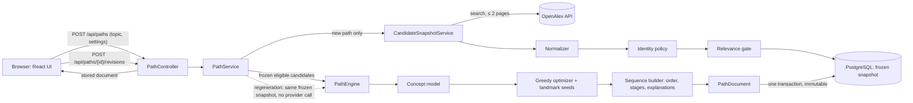

# Architecture

ResearchPath is a modular monolith: one Spring Boot backend (Java 21), one PostgreSQL database, and a React
single-page frontend. One external dependency: the OpenAlex API, called only by the backend.

## Data flow

1. **Retrieve (new paths only).** `CandidateSnapshotService` sends the topic to OpenAlex full-text search
   (default 100 candidates, max 200), with bounded retries, timeouts, a response-size cap and no redirects.
2. **Freeze.** Each work is normalized (`publication`), checked for duplicate versions (`identity`, conservative
   D06) and screened for relevance (`relevance`, conservative D07). Every snapshot member stores the exact
   normalized record it was evaluated with, so later cache refreshes cannot change history.
3. **Select.** `PathEngine` builds the concept model from the frozen pool (`concept`, topics + keywords), then the
   `optimizer` picks a complementary set: two reserved landmark slots for strongly relevant most-cited works (D16),
   then greedy marginal gain on weighted concept coverage plus a quality term (β = 4, D12), with at most one work
   per conservative title key (D18; same-titled works stay distinct records). The objective is monotone
   submodular: greedy keeps its (1 − 1/e) guarantee where no title repeats, and 1/2 under the title constraint.
4. **Order and explain.** `sequence` places overview-marked works first, uses citation links among the selected
   papers as weak evidence, falls back to chronology, names stages only from metadata, and writes template
   explanations from the recorded decisions (D09/D10).
5. **Store.** The complete result (`PathDocument`) is written in one transaction as an immutable revision; retrieval
   returns it unchanged. Regeneration reruns steps 3–5 on the original snapshot (D15).

The offline benchmark (`benchmark`, `scripts/benchmark.ps1`) runs the same `PathEngine` code on hash-pinned
datasets in `data/benchmarks/`; a parity test proves product and benchmark paths are identical.

## Backend packages (`backend/src/main/java/dev/researchpath`)

| Package | Responsibility | Pure? |
|---|---|---|
| `openalex` | HTTP client, retries, limits, error mapping | no (network) |
| `publication` | Normalizer, URL safety, publication cache | partly |
| `identity` | Duplicate/version policy (D06) and its persistence | policy pure |
| `relevance` | Relevance gate (D07), shared text pipeline | yes |
| `snapshot` | Retrieval → freeze; dev-only inspection API | no |
| `concept` | Coverage concepts from frozen inputs (D03/D08) | policy pure |
| `optimizer` | Objective, greedy selection, landmark seeds (D12/D16/D09) | yes |
| `sequence` | Reading order, stages, explanations (D10) | yes |
| `path` | Product API, immutable revisions, regeneration, retention | no |
| `benchmark` | Datasets, baselines, metrics, sweeps, ablation, CLI | yes (offline) |
| `web` | Error mapping, rate limits, body cap, security headers | no |

## Data model (Flyway V1–V7)

| Table | Holds |
|---|---|
| `publication` (+ authors, concepts, references, identity candidates) | Normalized OpenAlex cache, refreshable |
| `candidate_snapshot`, `snapshot_membership`, identity decisions | One frozen retrieval: members, exact normalized records, relevance tiers |
| `reading_path` | Opaque public id, original snapshot, topic, optional idempotency key |
| `path_revision`, `path_revision_item` | Immutable results (UPDATE rejected by triggers), fingerprint for identical inputs |
| `path_access` | Last view per path (retention) |

## Determinism and versions
Identical snapshot + settings + engine versions give an identical result (fingerprinted, stored once). Every
revision records its versions: optimizer, optimizer config (currently 3), concept policy, sequence builder and
document format. Pinned fingerprints in the test suite catch any unintended change in selection or order.

## Frontend (`frontend/src`)
`api/` (typed client mirroring `PathDocument`, problem-detail handling), `components/` (search form, path view,
paper cards, coverage, regeneration), `App.tsx` (URL state `?path=…&rev=…`, request isolation, duplicate-submit
guard). The UI renders stored results; it never recomputes selection, order or coverage.
