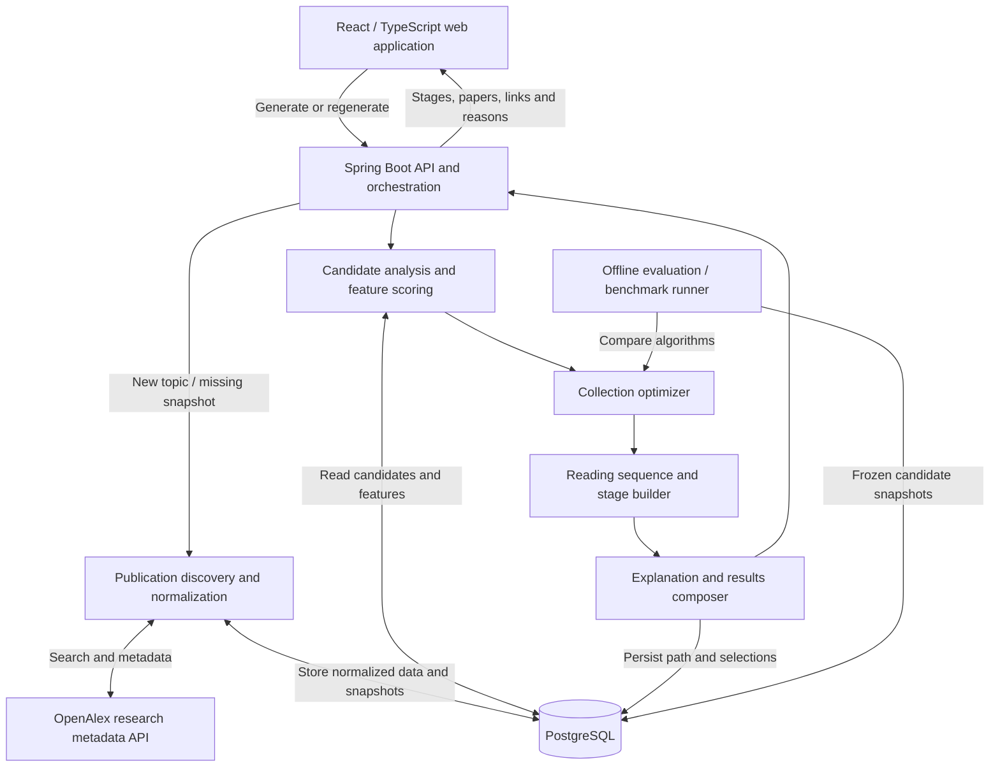
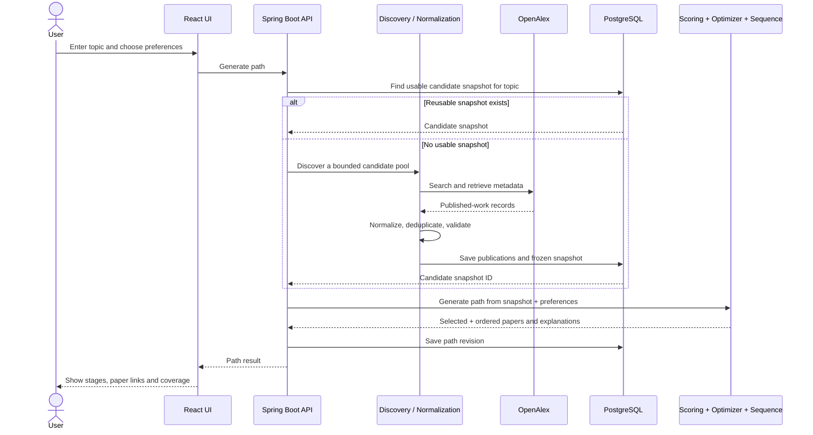
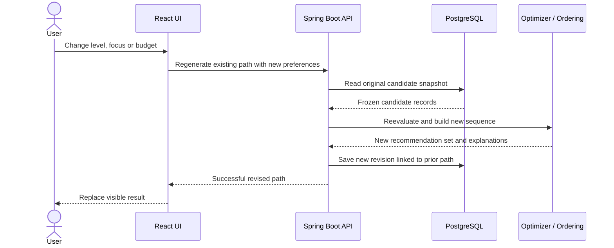
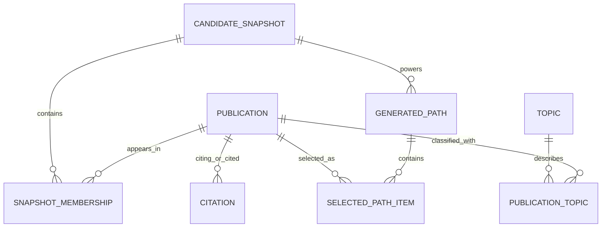

# ResearchPath
## Master Product Blueprint & Build Plan — MVP v1.1

**Project type:** Data-driven research discovery and learning-path optimization web application  
**Target timeframe:** 14 intensive development days  
**Primary audience:** Students and researchers  
**Primary use case:** Learn a topic through a structured sequence of genuine academic publications  
**Recommendation strategy:** Balanced by default, with foundational and recent-research preferences  
**Document status:** Build-ready product and system plan, updated using an initial live OpenAlex metadata audit; **not** an implementation specification  
**Last reviewed:** October 16, 2026  
**Evidence baseline:** Live OpenAlex audit at 2026-10-16 21:41:32 UTC; 30 top-ranked works across three queries  
**Version note:** v1.1 integrates actual audit findings, identifies unresolved questions, and supersedes v1.0

---

## Document navigation

- [0. How to use this document](#0-how-to-use-this-document)
- [1. Product vision and boundaries](#1-product-vision-and-boundaries)
- [2. Complete user experience](#2-complete-user-experience)
- [3. How the whole system fits together](#3-how-the-whole-system-fits-together)
- [4. Real research data](#4-real-research-data-what-enters-the-system)
- [5. Recommendation engine](#5-how-the-recommendation-engine-should-think)
- [6. Database and state](#6-database-and-state-what-must-be-remembered)
- [7. Backend and frontend boundaries](#7-backend-and-frontend-boundaries)
- [8. Error handling and trust](#8-error-handling-data-quality-and-trust)
- [9. Measuring performance](#9-measuring-whether-researchpath-is-actually-better)
- [10. Two-week build sequence](#10-two-week-build-sequence)
- [11. Definition of done](#11-definition-of-done--acceptance-tests)
- [12. Deferred features](#12-intentionally-deferred-features)
- [13. Risks and early decisions](#13-important-risks-and-decisions-to-validate-early)
- [14. First build session](#14-first-build-session-exact-outcomes-to-pursue)
- [15. Project handoff summary](#15-one-paragraph-project-handoff)
- [16. Audit evidence and change history](#16-audit-evidence-and-change-history)
- [Appendix C. Audit artifacts and follow-up protocol](#appendix-c--audit-artifacts-and-follow-up-protocol)

---

## 0. How to use this document

This blueprint is the shared source of truth for the initial ResearchPath build. It answers:

- **What** the product does and what a user should experience.
- **Why** each feature and backend component exists.
- **How** the frontend, backend, database, research provider, and optimization engine interact.
- **What data** must move between those components.
- **What makes a recommendation acceptable** and how to evaluate it.
- **What to build first**, what to postpone, and how to know the MVP is complete.

The intention is to make the next step—turning this plan into tickets, data models, service contracts, and code—straightforward without prematurely locking in class names, SQL schemas, mathematical constants, or implementation details.

**Product promise:** *Enter a research topic, choose your level and reading budget, and get a source-backed sequence of complementary papers organized to help you learn the subject.*

**Engineering promise:** *The selection and ordering are based on explainable, testable algorithms—not a black-box request for an AI chatbot to produce a reading list.*

### Evidence and decision-status legend

This document distinguishes what we **decided**, what the **initial audit actually observed**, and what remains to be validated. Do not turn preliminary observations into product guarantees.

- **LOCKED — product/architecture choice:** We intentionally chose it for the MVP (for example, Spring Boot, regeneratable paths, separate selection and ordering). It is not necessarily empirically proven superior.
- **OBSERVED — 30-paper audit:** It occurred in the supplied OpenAlex results. The sample has **10 search-ranked works per query**, so it is small and not representative of the whole corpus.
- **PROVISIONAL — implementation approach:** Reasonable plan, but coefficients, thresholds, candidate counts, and fallback policies must be tested against larger data and real output.
- **OPEN — unresolved or not yet measured:** We need an explicit test or decision before treating it as stable.

**Current project state:** Initial metadata feasibility audit is **complete**. The full-scale data audit, relevance and deduplication policies, scoring formula, actual optimizer, production data pipeline, benchmarks, and deployed system are **not yet built or validated**.

**Working references:** `REPORT.md` and `papers.csv` are the audit evidence; the original `researchpath_openalex_audit.py` generated the investigation. The CSV is an inspection export, **not** a complete production-ready work record.

### At a glance: locked decisions

| Area | MVP decision |
|---|---|
| Architecture | Modular monolith: one Spring Boot backend with clearly separated responsibilities |
| Backend | Java 21, Spring Boot |
| Frontend | React, TypeScript, Vite |
| Persistence | PostgreSQL and Flyway migrations |
| Academic data | OpenAlex as the primary provider; 30-work feasibility audit completed |
| Metadata interpretation | Broad topics **plus** finer keywords and query-relevance checks; all labels remain uncertain proxies |
| Deduplication | Cross-identifier/version resolution before optimizer; title equality alone is insufficient |
| Citation ordering | Best-effort supporting evidence; never require a connected graph |
| Optimization | Custom Java selection optimizer, followed by a separate sequence-building stage |
| Core output | Ordered stages containing up to 5, 10, 15, or 20 real papers |
| User controls | Topic, Beginner/Intermediate/Advanced, paper budget, Balanced/Foundational/Recent focus |
| Regeneration | Reuse the original candidate snapshot when preferences change |
| Accounts | None in v1 |
| Full-text/LLM summarization | Out of scope |
| Evidence of quality | Reproducible benchmarks, human spot-checks, automated tests, deployed demo |

---

# 1. Product vision and boundaries

## 1.1 The problem

Research search tools are good at returning documents, but **finding papers is not the same as knowing what to read first**. A newcomer may find hundreds of results that are overly specialized, repetitive, or difficult to connect. A more experienced reader may want to skip fundamentals without missing the influential work behind a modern method.

ResearchPath helps answer:

1. Where do I start learning this subject?
2. Which papers deserve a place in a limited reading list?
3. What does each selected paper add that the others do not?
4. In what order should I read them?
5. How can I adjust the path for a different knowledge level or research focus?

## 1.2 Target users

**Student / newcomer:** Wants a manageable starting point and foundational context. Their preference is likely **Beginner**, with fewer papers. The interface should avoid assuming familiarity with academic terminology.

**Intermediate learner:** Knows some context and wants to connect the field's major methods, applications, and later developments. Default configuration is designed around them.

**Experienced researcher:** Already knows the fundamentals and wants a focused route through specialized, influential, or newer work. Their preference is likely **Advanced** or **Recent**.

The MVP serves all three through the **same workflow**. It does not attempt to assess knowledge automatically, and it does not promise a certified curriculum or a complete literature review.

## 1.3 What distinguishes ResearchPath

Traditional ranking asks, "Which individual papers rank highest?" ResearchPath asks, **"Which combination of papers works well together, and in what order should someone approach it?"**

The main product value comes from:

- **Set-aware selection:** A paper is worth less if its contribution is already covered by selected papers.
- **Breadth with relevance:** Increase useful coverage without drifting away from the user’s topic.
- **Intentional sequence:** Distinguish selecting papers from ordering them.
- **Explainable decisions:** Show what each paper contributes and why it appears at that point.
- **Regeneration:** Let preferences change the result without unnecessarily fetching the same academic data again.

## 1.4 Explicitly *not* the goal

ResearchPath v1 is **not** a replacement for Google Scholar, a comprehensive systematic-review tool, a PDF reader, a paper-writing assistant, a chatbot, or a system that guarantees mastery of a subject. It does not create invented publications or summarize full text that it has not processed.

The distinction matters: our metrics describe the **candidate set and algorithm**, not proven improvements in learning outcomes.

---

# 2. Complete user experience

## 2.1 Screen A — Create a research path

The landing page has one primary action: **Build my research path**.

**Inputs and defaults**

| Input | Choices | Default | Why it exists |
|---|---|---|---|
| Research topic | Short natural-language phrase/question | Required; empty | Defines the area of research to discover |
| Experience level | Beginner / Intermediate / Advanced | Intermediate | Changes the balance between introductory and technical material |
| Paper budget | 5 / 10 / 15 / 20 | 10 | Controls the length of the learning path |
| Research focus | Balanced / Foundational / Recent | Balanced | Adjusts emphasis within the same topic |

**Behavior**

- The topic is the only required input; all other controls have sensible defaults.
- A user can type "graph neural networks," "reinforcement learning in robotics," or a more specific question.
- Whitespace-only topics are invalid. The interface has a reasonable character-length limit, not an artificially restrictive topic vocabulary.
- Selecting **Generate** submits one request. While in progress, prevent accidental duplicate submissions.
- Display a clear loading state (for example: "Finding papers" → "Building your path") **only when those states are genuinely known**. Do not fabricate detailed progress percentages.
- If a query is extremely vague (for example, "science"), suggest narrowing it. The MVP does **not** need a conversational topic-refinement system.

## 2.2 Screen B — Research results

A generated results page includes these sections, in this order:

**A. Path overview**
- Original topic as submitted.
- Selected experience level, paper budget, and research focus.
- Number of candidates **examined**, not an unsupported claim about the total number of relevant papers in the world.
- Number of papers actually selected, generation status, and when the candidate data was retrieved.
- If fewer papers than requested were eligible, explain why.

**B. Learning stages**
- Typically 2–4 stages, but not a fixed set for every topic.
- Each stage has a short, understandable label and one-sentence purpose.
- Papers are numbered across the whole path; their stage indicates where they fit in the progression.
- Example labels: *Foundations*, *Core Methods*, *Applications & Evaluation*, *Recent Directions*.
- Stage counts and labels must reflect the chosen papers; do not force every path into these four buckets.

**C. Each paper card**
- Actual title and author attribution where available.
- Publication year, type (e.g., review or preprint) when available, and original source/publisher or DOI link.
- Open-access link where available, clearly distinguished from a standard landing page.
- One or two grounded "Why it's here" reasons.
- A few meaningful topic/keyword tags.
- Position in the sequence and stage.
- No invented abstract, author, open-access claim, difficulty rating, or publication status.

**D. Coverage overview**
- A readable overview of which recognized subtopics or research areas occur in the selected plan.
- Optionally include an indicator of overlap or diversity **relative to the examined candidate pool**.
- Never label coverage of the provider’s available metadata as "86% of everything you need to know."
- A simple labeled breakdown is preferable to an arbitrary flashy score.

**E. Regenerate controls**
- Editable experience level, paper budget, and research focus.
- Topic remains visible and unchanged during regeneration.
- Regeneration presents a revised path rather than randomly shuffling the current one.
- Option to start a completely **new topic** separately.

## 2.3 Regeneration: a first-class MVP capability

**Definition:** Regeneration means running selection and ordering again with updated preferences against the **same previously collected candidate snapshot**.

Expected rules:

1. The user can change level, budget, and/or focus.
2. The current path stays visible while regeneration happens.
3. The backend reuses the existing candidate set and its associated metadata; it should **not automatically repeat the full OpenAlex search**.
4. A successful regeneration creates a new path revision and updates the visible result.
5. A failed regeneration leaves the current path unchanged and presents a retryable error.
6. The same snapshot + same settings + same optimizer version should produce the same ordering, apart from explicitly documented tie-breaking or source updates.
7. Selecting a different topic starts a **new discovery operation**, not a regeneration.
8. Individual paper locking, swapping, drag-and-drop ordering, and accounts are deferred.

**UX clarification:** The user is not guaranteed that every regenerated path has different papers. Changing preferences *may* produce the same valid selection; we should not introduce randomness to fake variety.

## 2.4 Example end-to-end journey

A user searches **"Graph neural networks for molecular property prediction"**, chooses **Intermediate**, **10 papers**, **Balanced**.

1. ResearchPath retrieves and evaluates a bounded group of relevant publications.
2. It selects complementary works spanning foundational graph concepts, molecular representations, model methods, and evaluation or application work.
3. It orders them into coherent stages and gives each paper a short grounded reason.
4. The user opens a DOI or available open-access version for actual reading.
5. The user switches to **Advanced**, **5 papers**, **Recent**.
6. ResearchPath re-scores and reselects from the **same data snapshot** with a stronger preference for specialized and recent work; the result may overlap with the first path.

This example illustrates behavior, **not** a promise to produce any specific paper or stage before testing real data.

---

# 3. How the whole system fits together

## 3.1 High-level component map

This is a **logical** diagram, not a request for nine deployable services. Discovery, scoring, optimization, sequencing, explanation, and orchestration are **modules inside one Spring Boot application**.

## 3.2 Component responsibilities and boundaries

| Component | Owns | Receives | Produces | Why separate it logically? |
|---|---|---|---|---|
| **Frontend** | Form inputs, loading/error states, displaying paths, regeneration UX | User actions and backend responses | Valid user requests and readable results | Keeps algorithm/business logic out of the browser |
| **API / orchestration** | Validation, request lifecycle, coordinating modules, response shape | Generate, view, regenerate requests | Completed path or clear status/error | One controlled entry point to backend behavior |
| **Discovery** | Search, bounded retrieval, provider communication | Topic + retrieval policy | Raw academic records | External provider details should not leak into optimizer |
| **Normalization** | Required fields, stable identifiers, duplicates, data quality | Raw provider records | Consistent publication models | Prevents messy external data from contaminating core logic |
| **Candidate analysis** | Relevance signals, topic features, citation influence, availability signals | Normalized candidates + user preferences | Comparable, explainable candidate features | Can be tested independently of retrieval |
| **Selection optimizer** | Choose the *set* of papers | Candidates, feature scores, paper budget | Selected publication IDs + reasons/scores | The project's central algorithm and benchmark target |
| **Sequence builder** | Reading order, citation-informed dependencies, stages | Selected papers and their relationships | Ordered and grouped recommendations | Selection and order solve different problems |
| **Explanation composer** | Convert recorded signals into truthful user-facing reasons | Scores, selected set, reading order | Short explanations and coverage overview | Prevents generic or invented explanations |
| **Persistence** | Publications, relationships, candidate snapshots, path revisions | Normalized facts and generated results | Consistent records for reuse and evaluation | Enables caching, reproducibility, and regeneration |
| **Benchmark runner** | Controlled experiments and baseline comparisons | Frozen snapshots and algorithms | Reproducible metrics and reports | Evaluating the model should not change what users see |

## 3.3 New-topic generation: interaction sequence

**Important:** The candidate snapshot is the boundary between "what data did we examine?" and "which papers did we choose?" That separation is central to reproducible evaluation and efficient regeneration.

## 3.4 Regeneration: interaction sequence

If any step fails, the UI retains the earlier path and surfaces the error; it does not delete or overwrite the successful revision.

## 3.5 Data-quality gate in the generation workflow (audit-informed)

Before any candidate reaches the optimizer, the discovery/normalization side must complete these checks in order:

1. **Source retrieval:** Fetch a bounded set of OpenAlex works and retain the source metadata needed for subsequent evaluation. Provider ranking is for *candidate retrieval*, not the final recommended path.
2. **Identity resolution:** Detect obvious ID/DOI matches and inspect likely version collisions (same or similar title, author and year). Preserve distinguishable scholarly versions until equivalence is defensible.
3. **Metadata availability:** Mark whether a title, identifiers, abstract, topics, keywords, citation references, publication type, and source links are available. A missing abstract is **not automatically a rejection**.
4. **Query relevance gate:** Reject clearly off-topic records before diversity/coverage optimization. This is particularly important for multidisciplinary terms that return governance, policy, or tangential application papers.
5. **Concept representation:** Keep broad topic memberships and finer keyword associations, ideally with their provider confidence values. Filter generic or unsupported tags when forming the *eligible* coverage universe.
6. **Frozen candidate snapshot:** Preserve the actual eligible work IDs, metadata inputs, retrieval context and filtering/configuration version. This prevents background refresh from changing old results or benchmark comparisons.
7. **Optimization and sequencing:** Only now select complementary papers and construct a cautious reading order, using citations when available and graceful fallbacks otherwise.

**Why this matters:** The first live audit found all three issues—coarse primary topics, absent abstracts, and uneven internal citation connections—plus titles likely representing multiple versions. Relevance eligibility, deduplication and missing-data handling are **preconditions** to a credible optimizer, not optional cleanup.

---

# 4. Real research data: what enters the system

## 4.1 Primary source: OpenAlex

Use **OpenAlex** as the sole required source for MVP v1. It provides searchable research work records, identifiers, authorship information, publication years, topics, keywords, citation/reference metadata, and links to known publication locations.

Useful official references:

- API overview: https://help.openalex.org/api/
- Authentication and usage limits: https://help.openalex.org/api/authentication/
- Work attributes: https://help.openalex.org/data/works/attributes/
- Citations: https://help.openalex.org/data/works/citations/
- Topics: https://help.openalex.org/data/topics/
- Keywords: https://help.openalex.org/data/keywords/
- Open-access locations: https://help.openalex.org/data/locations/

**Current provider considerations (as of October 16, 2026):** A free account can obtain an API key and a daily usage budget; quota/rate policies may change. Use server-side credentials, request only needed fields, avoid wasteful repeat searches, and gracefully handle budget exhaustion and rate limiting. The October 2026 topic-classification update is relevant: version/fetch-date tracking matters for reproducibility. Keywords are more specific than broad topics, but both are **automatically inferred metadata**, not guaranteed facts.

## 4.2 Paper information to retain

**Audit lesson (OBSERVED):** A narrow analysis export is not enough for the production pipeline. The supplied `papers.csv` gives descriptive topic/keyword strings, booleans for abstract presence, and *counts* of outgoing references. For production we need the available **confidence scores**, **actual abstract content**, and **referenced-work IDs/edges** (when provided), plus retrieval/source context. Store both normalized data and sufficient original provider evidence so later scoring changes do not require inventing missing values.

| Data | What it supports | Missing-data behavior |
|---|---|---|
| Stable OpenAlex work ID | Identity and deduplication | Exclude if it cannot be identified reliably |
| Title | Display and basic relevance | Exclude records with unusable titles |
| Authors / authorships | Correct attribution | Show "Author information unavailable" rather than fabricate |
| Publication date or year | Ordering context and recency | Keep only if remaining metadata suffices; label year unknown |
| DOI / publisher URL / OA URL | Open the source | Use the best verified alternative; distinguish OA from landing page |
| Abstract text / availability | Richer relevance and optional future concept evidence | Preserve actual available text; when absent use title, topics, keywords, and lower-confidence indicators |
| Research topics + confidence | Broad coverage grouping | Do not invent topics; degrade gracefully |
| Specific keywords + confidence | Fine-grained coverage and overlap | Fall back to topics if keywords are missing |
| Referenced work IDs and citation relationships | Graph edges and optional sequencing evidence | Do not substitute outgoing reference *counts* for actual graph connections |
| Citation count / contextual influence | Secondary influence feature; context-dependent | Counts alone are not quality or relevance; normalize conservatively |
| Duplicate/version identity evidence | DOI, work IDs, normalized title, authors, year, source/type | Store potential matches and conservative merge decisions with provenance |
| Normalized citation signal where available | Less biased influence estimation | Fall back conservatively; do not blindly sort by raw counts |
| Work type and publication source | Review/preprint context | Label when known; avoid unsupported peer-review assumptions |
| Data retrieval timestamp and provider/classification context | Reproducibility and freshness | Always store for saved snapshot |
| Field confidence and quality flags | Weigh weak tags, report limitations | Missing score is unknown, **not** zero or certainty |

**Important:** A citation is not inherently an endorsement or reading prerequisite. High citations do not automatically equal relevance or quality. Open-access metadata means an accessible copy may exist, not necessarily that our application can legally download and process every PDF.

## 4.3 Candidate discovery policy

Aim to examine **roughly 100–300 plausible candidates per topic** for the MVP, with a flexible lower count for narrow queries. This is a planning target—not a requirement to fill a pool with irrelevant results.

Discovery responsibilities:

1. Search work records for the topic.
2. Retrieve a bounded collection and sufficient metadata.
3. Normalize publication identity, links, years, subjects and authors.
4. Merge duplicate or overlapping identities **only with sufficient evidence**; prioritize exact DOI/known-identifier matches, then treat similar normalized titles, authors and dates as *possible* same-work or different-version cases. Do not merge different DOI book chapters solely because the title matches.
5. Reject empty/unusable records and flag incomplete records without misrepresenting them.
6. Apply a basic relevance eligibility screen **before** the optimizer's diversity scoring. Distinguish a paper about the searched technique from one that only discusses policy, economics, education, or a distant application, unless that is what the user asked to learn.
7. Create a **candidate snapshot** containing the exact considered records, relevant provider metadata version/fetch date, and any recorded filtering criteria.

**No promise of exhaustive retrieval.** The resulting path is optimized over the considered candidate collection, not the entire literature corpus.

**Sample-size policy (PROVISIONAL):** The 100–300 candidate target is a planning assumption. We only tested 10 top-ranked records per query. Before fixing a default, compare larger pools (e.g., 100–200 per topic) including results beyond the first-ranked page. Measure API cost/latency, metadata missingness, tag noise, off-topic drift and distinct usable concepts. A bigger pool is not necessarily better if most candidates are irrelevant.

## 4.4 Why a candidate snapshot matters

A snapshot is a named, reproducible set of candidate papers with the data needed to evaluate them. The same snapshot can produce multiple paths—for example, Beginner + 5 papers and Advanced + 20 papers—without recollecting all metadata.

It also lets us conduct fair algorithm comparisons. A baseline and our optimizer must evaluate the **same candidates with the same inputs**, not two different API search results.

Snapshots may be refreshed for a **new generation request** when stale. They are not silently changed beneath an existing path revision. Keep old snapshot versions available for saved benchmark runs until retention rules permit cleanup.

## 4.5 Initial OpenAlex audit — evidence we now have

**Status: OBSERVED, but limited.** Live metadata audit on **2026-10-16**, collecting the **first 10 OpenAlex search-ranked records** for each of the three queries. Classification thresholds used by the audit: topic score ≥0.15; keyword score ≥0.25. Percentages below describe only **those returned records under those thresholds**.

| Query | Records | Abstracts available | ≥1 topic | ≥1 keyword | Distinct topic labels | Distinct keywords | Most common primary topic | Citation edges *within the 10 records* |
|---|---:|---:|---:|---:|---:|---:|---:|---:|
| Graph neural networks | 10 | 9/10 (90%) | 10/10 | 10/10 | 3 | 55 | 8/10 (80%) | 17 |
| Reinforcement learning in robotics | 10 | 6/10 (60%) | 10/10 | 10/10 | 1 | 53 | 10/10 (100%) | 5 |
| AI-assisted medical diagnosis | 10 | 8/10 (80%) | 10/10 | 10/10 | 5 | 103 | 6/10 (60%) | 0 |

**What this supports:**

- **Topic-only coverage is insufficient as a general default.** The robotics example assigns the same primary topic to every sampled work even though fine-grained keywords vary. Graph neural networks show a similar, less extreme concentration.
- **Keywords are valuable *candidate* subtopic signals**, not automatic proof of useful diversity. Keyword lists may contain generic terms, inaccurate model assignments, near-synonyms or terms irrelevant to the requested learning goal.
- **Missing abstracts are a normal case**, not exceptional. The robotics sample lacked abstracts in 4/10 records; the main experience cannot require one for every recommended item.
- **The selected-paper graph can be sparse or disconnected.** Zero internal edges in the small medical-AI sample means the ordering engine must function without citation connections; it does **not** establish that papers in that field do not cite each other.
- **Potential duplicates/versions exist.** The graph sample includes two 2020 records named *A Comprehensive Survey on Graph Neural Networks* (one with DOI, one without); robotics contains a survey article and book chapters sharing a very similar title. We need identity resolution, not an automatic same-title deletion rule.
- **Top-ranked results can contain divergent intents.** The medical-AI sample mixes technical diagnosis, policy, economic governance, explainability and education. Relevance must be judged relative to the *user's specific query*, not by diversity of tags alone.

**What this does NOT establish:** Final relevance thresholds; reliable semantic usefulness of each keyword; optimal scoring weights; learner difficulty; the educational validity of stage ordering; citation connectivity at the 100–300-paper scale; API response-time targets; actual algorithm superiority. These remain **OPEN**.

**Source artifacts:** `REPORT.md` (audit summary, example records, flags), `papers.csv` (30 normalized paper rows). If the original `raw/*.json` snapshots are available locally, preserve them alongside the run configuration for reproducibility; they were not required to make the above descriptive claims.

## 4.6 Practical data policy after the audit

Use **two levels of classified concepts**:

- **Broad topic groups:** Help users see the major research directions in their path and act as a coarse fallback when more specific evidence is unavailable.
- **Finer keywords:** Supply candidate subtopic coverage and similarity signals for selection and explanations; weigh by provider confidence when available and filter generic or weakly supported labels.

The application should **not** maximize the raw number of different keywords. A query can have 103 unique keyword labels without all 103 representing meaningful learning objectives. We need a small, relevant *coverage universe* drawn from eligible candidates; consider normalizing obvious synonyms and penalizing generic labels once tested. Do not assume a single OpenAlex topic means every paper is redundant.

For **abstract missingness**, continue with available trustworthy fields and record confidence/limitations. For **citations**, maintain actual directed work IDs where available and provide a non-graph fallback sequence. For **possible duplicate versions**, retain provenance and a canonical display choice only when evidence is sufficient. For **off-topic subareas**, screen relevance first; the optimizer should not reward a paper solely for introducing fresh but irrelevant terms.

---

# 5. How the recommendation engine should think

This section describes **behavior and responsibilities**, not the final scoring formula or Java implementation.

## 5.1 Two separate questions

**Question A — Selection:** Which group of papers offers a useful, relevant, complementary foundation under the user's reading budget?

**Question B — Sequencing:** Given that selected group, what is a defensible progression from introductory or foundational reading toward deeper or newer work?

Do not fold these into one opaque "paper quality" number. They can use related evidence, but they solve different problems.

## 5.2 Evaluate each candidate using interpretable signals

**Audit-informed constraint:** Broad provider topics are a poor standalone coverage feature. Each candidate should retain **both** broad topic associations and more specific keywords (with confidence when available); use text/context evidence when available to reduce misclassification. Compute an explicit **eligibility/relevance decision before** considering that paper for coverage optimization.

**Relevance:** Does the paper actually relate to the user's topic or research question? This is an eligibility gate as well as a scoring factor. A famous paper on the wrong subject should not qualify.

**Coverage:** Which subareas does it represent? Use topic groups **plus** more specific keyword labels and confidence to recognize overlap and novel contribution. The coverage universe should be built from the **eligible candidate snapshot**, with generic, low-confidence, off-topic or duplicate labels filtered out. Avoid rewarding the count of raw unique keywords: a paper is not necessarily more educationally valuable because its provider supplied more tags.

**Influence:** Does the publication meaningfully shape its area? Consider normalized citation context if available, not just absolute citation count. New papers should not be automatically dismissed because they have had no time to accumulate citations.

**Experience fit / accessibility:** For Beginner, cautiously favor introductions, surveys and foundational explanations **when the data supports that interpretation**. For Advanced, permit specialized technical work. Do not claim to have measured objective reading difficulty from metadata alone. Missing difficulty evidence should be treated as unknown.

**Recency:** More recent research can be useful, especially under Recent focus, but recency is not proof of higher quality or greater relevance.

**Relationships:** Citation and topic relationships can help determine whether a paper contributes background, bridges subjects, or relates to another selected work. These relationships are evidence, not incontrovertible facts about pedagogy. In the audit, within-sample edge counts ranged from 0 to 17; therefore **no citation edge can be required for eligibility or ordering**.

All signals should be internally inspectable so we can explain selections and diagnose poor results.

**Provisional scoring hierarchy (not frozen weights):**

1. **Hard gate:** Is the paper relevant and identifiable enough to consider? A strong coverage score cannot rescue an off-topic paper.
2. **Main selection objective:** Maximize meaningful *marginal* coverage while retaining strong per-paper relevance; allow appropriate overlap.
3. **Secondary preferences:** Influence, recency and beginner/advanced suitability, applied modestly and with missing-data fallbacks.
4. **Ordering stage:** Use available structure and weak citation/review/chronology cues to create a defensible, transparent path; never present heuristic sequencing as proven prerequisite knowledge.

**Still OPEN:** Exact normalization, generic-term filtering, topic-versus-keyword balance, relevance thresholds, survey detection, influence adjustment, metadata-confidence discounts, and preference weights. Validate these using larger and manually inspected frozen candidate pools. Do not silently set unsupported default scores to maximum quality.

## 5.3 The set-selection optimization behavior

A normal top-10 ranking chooses the individually highest-scoring ten papers. Our optimizer instead repeatedly considers **how much a candidate adds to the collection already chosen**.

Illustration:

- Paper A introduces concepts 1, 2, and 3.
- Paper B is highly relevant but mostly duplicates A.
- Paper C contributes concepts 3, 4, and 5.
- Paper D contributes concepts 6 and 7.
- A 3-paper budget may favor **A + C + D** over **A + B + C**, even if B has more citations than D.

The **starting selection approach** is weighted greedy marginal-coverage optimization with a clear individual-quality component. At each step, the engine asks, *"Which eligible, unselected paper brings the greatest incremental benefit now?"*

Product constraints:

- Apply identity resolution and relevance eligibility before greedy set selection; select from *eligible canonical works*, not raw search rows.
- A novel keyword or niche category does not justify including a tangential paper.

- **Never exceed** the user’s paper budget.
- No duplicate papers or duplicate identifiable versions.
- Do not fill unused slots with clearly irrelevant papers.
- Relevance must stay strong enough that diversity does not turn into off-topic wandering.
- Permit some overlap when it serves a purpose—two foundational papers on the same major concept may both be valuable.
- Deterministic tie-breaking for repeatable results.
- Record each selected paper’s incremental contribution at selection time.

**How to think about redundancy:** Prefer diminishing returns on already-covered topics rather than an arbitrary global rule that every paper must introduce entirely different material. Learning sometimes requires multiple perspectives on a central concept.

### Experience and focus controls

Experience level and focus adjust priorities within **the same engine**:

| Setting | Intended effect | Guardrail |
|---|---|---|
| Beginner | More accessible introductions, surveys and conceptual foundations | Do not falsely label a technical article "easy" |
| Intermediate | Balanced foundations, major methods and applications | No assumption that the learner knows every prerequisite |
| Advanced | More specialized technical and influential work | Still include foundations when genuinely needed |
| Balanced | Useful combination of earlier work, central methods and newer directions | Do not optimize solely for diversity |
| Foundational | Favor important earlier work and conceptual history | Older does not always mean foundational |
| Recent | Favor relevant recent developments | Do not crowd out necessary background or treat recency as quality |

Avoid freezing untested percentage weights at the blueprint stage. Begin with reasonable relative priorities, then validate with multiple topic samples and adjust only when evidence justifies changes.

## 5.4 Build a reading sequence *after* selecting the set

Once the paper set is selected, build an ordered reading list with evidence such as:

- Introductory or survey work generally before deep specialization, when identifiable.
- Relevant foundational concepts before papers that clearly depend on them.
- Citation directions and publication chronology as **weak ordering evidence**.
- Learning-level preferences (e.g., advanced users may reasonably enter later in a field).
- Clear fallback ordering when metadata cannot justify stronger claims.

**Critical warning:** Citation edges do **not** prove prerequisite relationships. The sequence must be described as *recommended*, not objectively optimal. **Audited reality:** One ten-paper sample had **zero** citation edges *within that sample*. When selected works contain no edges, fall back to metadata-supported introductory/review signals and a consistent, cautiously labeled ordering rather than fabricate relationships.

After ordering, group the sequence into a small number of learning stages. Stage labels and descriptions must be supported by the actual topic tags and ordering logic. If reliable labels are unavailable, prefer neutral stage names and transparent uncertainty instead of invented pedagogical claims.

## 5.5 Explain choices without hallucinating

The explanation layer should translate recorded factors into user-friendly sentences. It should not make up what is inside an unread paper.

**Supported examples:**
- "Introduces a research area not strongly represented elsewhere in this path."
- "Frequently referenced by other selected publications."
- "Adds a recent perspective on this subtopic."
- "Selected as a review article based on its publication metadata."

**Avoid unsupported examples:**
- "This is the easiest paper for beginners."
- "Reading this guarantees understanding the following methods."
- "This paper proves that approach X is better" without examining the text/evidence.

Explanations should disclose when evidence is insufficient. A short accurate reason is better than a confident but fabricated one.

## 5.6 Outputs produced by the engine

The engine returns a structured result with:

- Candidate snapshot and algorithm version identifiers.
- User settings used to generate the path.
- Selected publication IDs in recommended reading order.
- Stage grouping and labels.
- Recorded contribution/selection reasons.
- Coverage information with a clearly defined denominator (the eligible candidate pool).
- Warnings for missing data, limited candidates, or low-confidence organization.

The frontend renders these results. It does **not** recompute or reinterpret the recommendations independently.

---

# 6. Database and state: what must be remembered

PostgreSQL serves two purposes: **a durable research metadata cache** and **a record of exactly what generated each recommendation**.

This is a **conceptual domain model**, not a table-by-table SQL specification.

| Logical record | Purpose | Key relationships |
|---|---|---|
| **Publication** | One normalized academic work | Referenced by snapshots and generated paths |
| **Publication metadata / authors** | Titles, authors, years, types, identifiers, source links, data quality markers | Belongs to a publication |
| **Topic / keyword association** | Broad topics and fine keywords, each with source/confidence when available; keep their types distinct | Many papers may share a topic or keyword |
| **Publication identity / version aliases** | Related OpenAlex IDs, DOIs, normalized title/author/year evidence and conservative equivalence decisions | Supports canonical candidate selection and traceable versions |
| **Metadata availability / provenance** | Missing-abstract flags, provider retrieval context and raw/normalized field version | Records what evidence existed when an algorithm ran |
| **Citation relationship** | Directed "Paper X references Paper Y" evidence | Links two known publication IDs where possible |
| **Candidate snapshot** | Frozen, named pool of eligible candidates for a topic and retrieval policy | Has many snapshot publications; may support many paths |
| **Snapshot membership** | Which papers were included, with relevant feature/source versions | Connects snapshot and publications |
| **Generated path** | Topic, requested preferences, algorithm version, status and timestamps | Uses exactly one candidate snapshot |
| **Selected path item** | Selected paper, order, stage, contribution and explanation | Connects a generated path and publication |
| **Path revision lineage** | Relates a regenerated result to the earlier path | Optional parent/revision relationship |
| **Evaluation record** | Controlled comparison with data version and results | References snapshots, algorithms and metrics |

### Conceptual relationships

**Design notes:**

- A publication should not be duplicated every time someone searches for it.
- A stored snapshot preserves the **exact set and relevant scoring inputs** used for generation, even when the global publication cache is later refreshed.
- A generated path is immutable once successful; regeneration creates a new revision rather than changing the old one in place.
- Papers and topic labels may have missing or changing provider fields. Save retrieval timestamps and preserve what supported historical decisions.
- **Audit-specific storage requirement:** Persist scored topic/keyword associations rather than only comma-separated tags, and actual referenced work IDs rather than just counts. Original audit CSV fields are not sufficient for the full optimizer.
- Keep **possible duplicates** distinct until DOI/identifier or stronger multi-field evidence supports canonicalization. Record what got merged and why; a matching title by itself is ambiguous.
- Store whether an individual field was missing, derived, or supplied by OpenAlex; the optimizer should be able to explain low-confidence choices and reproduce old versions.
- Because there are no user accounts, generated paths can have unguessable share/view identifiers; do not treat a predictable database ID as authorization for private future features.
- Apply retention/cleanup for old anonymous paths and snapshots so a public demo cannot grow without bounds.

### Cache policy at the product level

1. **Publication cache:** Reuse normalized metadata when sufficiently fresh.
2. **Search / candidate cache:** Reuse a suitable topic snapshot for repeated similar requests when appropriate.
3. **Regeneration:** Always reuse the original snapshot by default, even if newer data has since become available.
4. **Refresh research:** A separate action (future or optional MVP enhancement) may create a **new** snapshot, but should not silently alter a prior path.

This distinction helps with provider costs, speed, reproducibility and debugging.

---

# 7. Backend and frontend boundaries

## 7.1 Recommended tech stack

| Layer | Choice | Why |
|---|---|---|
| Language | Java 21 | Leverages existing backend skills and suits algorithm implementation |
| Backend | Spring Boot | REST endpoints, validation, external calls and modular business logic |
| Persistence | PostgreSQL | Durable records and relational connections between papers and snapshots |
| Schema management | Flyway | Repeatable migrations across local, tests and deployment |
| Data access | Spring Data JPA, with direct queries if necessary | Familiar persistence while allowing optimization where useful |
| Frontend | React + TypeScript + Vite | Fast to build a polished research form and results interface |
| Testing | JUnit, Mockito, Testcontainers, WireMock | Algorithm, database and provider-failure confidence |
| Build/deployment | Docker + CI via GitHub Actions | Reproducibility and clear demonstration |
| Hosting | A suitable container host plus managed Postgres, static frontend host | Deliver a working public demo without complex infrastructure |

**Not needed in v1:** Kafka, Kubernetes, microservices, graph database, vector database, a separate Python model service, full-text embedding pipelines, or an LLM. Add any of these only after identifying a real problem they solve.

## 7.2 Logical backend modules

Proposed *responsibilities* (not fixed package names):

- **Path request orchestration:** Validate input, resolve snapshots, coordinate generation, persist outcome.
- **OpenAlex client:** Make controlled external requests and interpret provider failures.
- **Publication discovery and normalization:** Produce consistent candidate records, enforce data-quality flags, resolve possible duplicate/version identities, and apply the pre-optimization relevance eligibility screen.
- **Research metadata store:** Save/load publications, classifications, citations, snapshots, paths.
- **Candidate evaluator:** Turn data and preferences into explainable features while combining broad topics with relevant fine keywords and tracking missing evidence.
- **Set optimizer:** Select complementary publications within budget.
- **Sequence builder:** Determine ordering and stage structure.
- **Explanation builder:** Convert evidence into grounded messages.
- **Evaluation and diagnostics:** Run baselines, benchmark timing and data quality checks; incorporate the existing Python audit as a reusable **development tool**, not a required production microservice.

Each module should expose a small, intentional interface to the next one. The optimizer should be testable using **in-memory candidate data** without Spring, PostgreSQL or OpenAlex.

**Critical boundary after the audit:** The external provider supplies *observations*, the normalization layer supplies *usable, provenance-aware candidates*, the relevance gate decides *eligibility*, the optimizer chooses a *complementary subset*, and the sequence builder defines the *recommended order*. Each should be independently testable. The React frontend neither decides what qualifies as a paper nor recomputes eligibility/coverage.

## 7.3 External-facing operations (conceptual API contract)

The frontend needs only a small set of application operations. Exact paths and JSON shape can be specified later.

| Operation | Input | Expected output |
|---|---|---|
| **Generate path** | Topic, experience, budget, focus | New path identity and complete result, or status if asynchronous |
| **Get path** | Path identity | Last completed persisted result and its settings |
| **Regenerate path** | Existing path identity + updated preferences | New path revision using original candidate snapshot |
| **Health/status** | None | Service is reachable and dependencies are healthy at the chosen level |

A response should have one consistent representation of papers, stages, warnings and selection reasons, regardless of whether it came from initial generation or regeneration.

Start with a straightforward request/response design if real uncached generation times are acceptable. If retrieval can exceed practical request timeouts, introduce a bounded background job with explicit **queued / running / succeeded / failed** states and a status operation. This can remain inside one Spring Boot application. **Do not pretend a job queue exists until it is implemented.**

## 7.4 Who owns what?

- **Frontend owns:** input state, form validation feedback, visual layout, user navigation, showing loading/results/errors, preserving prior visible result during regeneration.
- **Backend owns:** authoritative validation, candidate selection, scoring, stage ordering, all explanation evidence, snapshot decisions, data quality, path persistence.
- **Database owns:** durable identity, relationships, snapshots, revisions and cached publication data.
- **OpenAlex owns:** externally supplied research metadata; it does **not** choose the user's learning path.

This division prevents a later frontend redesign from changing algorithm behavior and keeps results reproducible.

---

# 8. Error handling, data quality and trust

| Situation | Desired behavior |
|---|---|
| Blank / extremely short topic | Explain problem before submit; backend validates too |
| Very broad topic | Suggest narrowing and/or clearly label a general-overview result if meaningful |
| Too narrow / few relevant papers | Return fewer than requested with an explanation, rather than padding |
| No relevant results | No-results state with actionable topic-edit guidance |
| Missing abstract | Use titles/classifications as fallbacks and lower confidence; robotics audit saw only 60% availability |
| Missing topic / keyword data | Lower confidence; use fallbacks; do not invent classification |
| Duplicate DOI/preprint/journal versions | Audit showed same or near-identical titles under different IDs; assess DOI, author, year, work type and version before merging |
| Missing citation network edges | One audit sample had zero internal edges; sequence still works using cautious fallback rules |
| Paywalled paper | Link to publisher/DOI and mark OA status only when supported |
| Provider timeout, 429 or quota exhaustion | Retry reasonably when applicable; return clear failure or use known usable cached snapshot |
| Search finds low-quality candidates | Medical-AI audit included policy/economics/education alongside technical papers; filter by the actual learning intent before coverage optimization |
| Extremely many one-off keywords | Check relevance, specificity, confidence and synonym overlap; do not treat keyword count as educational breadth |
| Sparse or biased audit sample | Mark conclusions provisional and repeat with larger/more varied candidates; do not extrapolate 30 search-ranked records to an entire field |
| Regeneration fails | Keep existing result and allow retry without losing prior state |
| Repeated clicks / simultaneous requests | Prevent accidental duplicate work and unreasonable resource use |
| Metadata changes | Keep historical snapshot/revision consistent; make newer retrieval a separate operation |

**Security and responsible use**

- Keep OpenAlex credentials on the server; do not ship them in frontend bundles or commit them to source control.
- Validate and constrain user input and query size; protect against injection, abusive request volume and excessive external usage.
- Use reasonable timeouts and rate limiting; bound candidate counts and cache storage.
- Treat paper titles/abstracts as untrusted external text and render them safely; do not execute instructions found in papers or external metadata.
- Never invent citations or show fabricated bibliographic details.
- Link to publisher/DOI/OA destinations; do not scrape protected full text or assume permission to redistribute PDFs.
- Keep operational logs free of unnecessary personal information. There are no accounts in the MVP.

---

# 9. Measuring whether ResearchPath is actually better

The project should ship with a **repeatable experiment**, not a guessed resume claim.

## 9.1 Baselines

Compare on the exact same frozen candidate pools, budgets and input settings:

1. **Citation baseline:** Select the most-cited eligible papers.
2. **Relevance baseline:** Select the individually most relevant eligible papers.
3. **ResearchPath:** Greedy marginal-gain collection optimization.
4. **Optional improvement:** ResearchPath followed by a local swap/refinement pass.

For very small pools, compare the chosen set with an exhaustive or exact optimizer to see whether the greedy approach approaches the best score under the defined objective. This is for correctness and objective-quality evaluation, not proof of educational value.

## 9.2 Primary measures

**Do not confuse metadata diversity with educational coverage.** A keyword-level measure should only count *eligible, normalized, query-relevant* labels; run independent relevance checks and expose how the coverage universe was constructed.

| Metric | Interpretation | Caveat |
|---|---|---|
| Weighted coverage over eligible candidate labels | How broadly the selected set represents meaningful topics in the considered pool | Depends on provider classification quality |
| Redundancy / overlap | How much selected papers repeat common classified subject matter | Some repetition is educationally valuable |
| Relevance retention | Does diversification keep selected papers on-topic? | Must be assessed independently of coverage |
| Influence mix | Are influential/recognized works represented appropriately? | Citation count is biased by age, field and availability |
| Runtime | Time spent scoring, selecting and ordering | Separate algorithm time from API fetch time |
| Constraint adherence | No duplicates, budget respected, eligibility maintained | Necessary for correctness, not sufficient for utility |
| Regeneration cost | Reduction in provider calls and end-to-end time when reusing a snapshot | Compare like-for-like runs |
| Eligibility relevance check | Fraction of manually reviewed recommendations directly relevant to user intent | Separate from any coverage score used in selection |
| Metadata completeness | Abstract/topic/keyword/reference availability within each **actual candidate pool** | Initial 30-paper audit is only a baseline signal |
| Duplicate/version precision | Were distinct publications wrongly collapsed or equivalent versions repeated? | Measure on manually adjudicated examples, not title equality alone |
| Preference sensitivity | Do beginner/advanced/foundational/recent options meaningfully change supported results? | Avoid interpreting any change as an automatic improvement |

## 9.3 Human quality check

Automated scores alone can mislead because we partly designed the optimizer to maximize them. Conduct a simple manual review on **at least 8–12 varied research topics** (for example, computing, energy, biology, social science, and interdisciplinary topics).

For each, record:

- Are key subtopics *actually* relevant to the user question, or are they generic keyword artifacts?
- Do near-duplicate versions appear multiple times or get incorrectly merged?

- Are the selected papers clearly related to the topic?
- Does the set cover distinct major subareas, not just synonyms?
- Is any obviously foundational area missing?
- Does the reading order seem defensible?
- Are explanations grounded rather than speculative?
- Would Beginner versus Advanced settings cause a sensible change?
- Are any titles, metadata, or access links wrong?

A small, transparent manual rubric is more credible than claiming "learning improved by 40%." Human review does not need to prove educational outcomes; it is a quality sanity check.

## 9.4 Benchmark reproducibility requirements

Every reported experiment should record:

- Research query and user settings.
- Candidate snapshot identifier and retrieval date.
- Algorithm version/configuration.
- Baseline definitions.
- Paper budget and number of candidates.
- Metric definitions and results, including failures or weak topics.
- Environment for runtime measurement and whether provider fetch time was included.

**Resume bullet rule:** Only use measured percentages from repeatable evaluation. Say **"increased measured candidate-topic coverage by X% relative to a relevance-only baseline"**, not "helped people learn X% faster" unless a future study actually demonstrates that.

---

# 10. Two-week build sequence

This order minimizes the risk of polishing a frontend around an unproven algorithm.

| Days | Primary deliverable | What should work by the end |
|---|---|---|
| **1–2** | Foundation + follow-up data checks | **30-paper feasibility audit already complete.** Start repo/backend/frontend/database; inspect a larger, less top-heavy sample and test metadata/identity assumptions |
| **3–4** | Ingestion and persistence | Retrieve a bounded real candidate set; persist confidence-aware topics/keywords, actual referenced IDs, missing-data flags, version-resolution evidence and a frozen snapshot |
| **5–6** | Relevance gate, features and baselines | Separate relevant versus tangential records, apply conservative deduplication, compute features, and build relevance/citation baselines |
| **7–8** | Core optimizer and sequence | Greedy selection adds distinct *relevant* concept coverage; produce ordered stages **with or without citation edges** from fixed data |
| **9** | Path persistence and regeneration | Save a completed path, reload it, regenerate with new preferences from the same snapshot |
| **10–11** | Usable web interface | User can enter topic/settings and explore a full paper-by-paper path, sources and regeneration |
| **12** | Reliability and edge cases | Integration tests, mock provider failures, missing metadata, duplicate and budget checks |
| **13** | Evaluation + polish | Frozen baseline comparisons, manual relevance/version/stage review, coverage sensitivity and interface refinements |
| **14** | Deployment + documentation | Live demo, setup guide, project description, benchmark methodology/results, demo walkthrough |

### Major checkpoints

**Checkpoint A — End of Day 4:** Real academic metadata is flowing into a usable local data model and persisted snapshot.

**Checkpoint B — End of Day 8:** A backend-only demo can take a frozen set of real papers and produce an explainable ordered path. This is the **highest-priority checkpoint**.

**Checkpoint C — End of Day 11:** A person unfamiliar with the code can create, view and regenerate a path in a browser.

**Checkpoint D — End of Day 14:** It is deployed, tested, documented and backed by actual measurements.

### If time runs short, cut in this order

1. Elaborate visualizations and sophisticated charts.
2. Fancy dynamically named learning stages; use accurate simple headings instead.
3. Multiple complex paper explanations; use one or two well-supported reasons.
4. Optional performance optimizations and secondary provider integrations.

**Do not cut:** Correct data identity, meaningful set optimization, source links, regeneration from snapshots, basic tests, and at least one credible benchmark against simple ranking.

---

# 11. Definition of done / acceptance tests

The MVP is ready to call **finished** only when these observable conditions hold:

### User-facing

- [ ] A new visitor can enter a research topic and generate a learning path without signing in.
- [ ] Beginner, Intermediate and Advanced, paper count and research focus are selectable.
- [ ] The result contains real identifiable works, ordered and grouped into understandable stages.
- [ ] Each work has grounded metadata, a usable source link and a truthful selection explanation.
- [ ] The result shows coverage context without making unsupported completeness claims.
- [ ] Users can change preferences and regenerate the existing topic without repeating the entire source discovery.
- [ ] A failed regeneration preserves the earlier successful path.
- [ ] Empty results, sparse metadata and provider failures lead to clear states rather than broken UI.

### Backend / data

- [ ] The application persists normalized publications, relationships, candidate snapshots and generated path revisions.
- [ ] Duplicate identifiable works are not repeated in one path; distinct valid versions are not incorrectly collapsed just because titles match.
- [ ] The candidate snapshot retains relevant topic/keyword confidence, available abstract evidence and referenced-work IDs where supplied.
- [ ] A missing abstract does not automatically disqualify an otherwise usable paper.
- [ ] A path can be generated without any citation edges among selected works.
- [ ] Results never exceed the selected paper budget and do not fill slots with clearly irrelevant papers.
- [ ] Identical snapshot + preferences + algorithm version results are deterministic.
- [ ] External provider credentials are not exposed to the client.
- [ ] Database and provider interactions are covered by meaningful automated tests.

### Algorithm / evaluation

- [ ] Set selection uses marginal contribution rather than just sorting by one field.
- [ ] Learning sequence is a distinct, testable step.
- [ ] The project documents where accessibility and prerequisite estimates are uncertain.
- [ ] At least two baseline methods are implemented for comparison.
- [ ] Benchmarks run against frozen datasets with documented metrics.
- [ ] Keyword diversity does not reward obvious off-topic or generic labels; relevance remains a separately evaluated guardrail.
- [ ] Larger-than-initial sample and a small human relevance/duplicate/version audit are documented, even if some design choices remain provisional.
- [ ] Real results—including disappointing outcomes—are recorded transparently.

### Shipping

- [ ] The frontend and backend are deployable and a reviewer can access a working demo.
- [ ] The repository contains setup instructions, architecture overview, screenshots/demo and benchmark report.
- [ ] The README accurately describes the product’s capabilities and limitations.

---

# 12. Intentionally deferred features

Do **not** build these into the first two weeks unless the entire MVP above is finished:

- Authentication, profiles, follower/social features or saved personal libraries.
- PDF upload, paper annotation or in-app PDF reader.
- AI-generated paper summaries, chat or LLM-generated reading plans.
- Full-text indexing or expensive semantic embedding infrastructure.
- Paper-level lock/remove/replace controls and drag-and-drop reordering.
- Progress check-ins, quiz generation or learner assessment.
- Export to citation managers or collaborative plans.
- Interactive large citation graph visualizations.
- Multiple academic data providers and universal global search.
- Production-grade distributed job processing, Kubernetes or microservices.

**Natural v2 ideas:** skip already-read papers and regenerate; manual pin/swap; finer prerequisite modeling; optional estimated reading time; alternate path comparison; citations graph explorer; saved libraries; user feedback on ordering quality.

---

# 13. Important risks and decisions to validate early

| Risk | Why it matters | MVP mitigation |
|---|---|---|
| Topic categories are too coarse **(OBSERVED in 30-work audit)** | All relevant papers can appear to cover the same broad subject | Combine fine keyword evidence with broad topics; validate semantic accuracy before awarding coverage |
| Classification labels are wrong or missing | Coverage and explanations may mislead | Track confidence, conservative fallbacks and truthful missing-data states |
| Citation counts bias toward older popular work | Foundations can dominate newer contributions | Contextualize influence; cap or normalize it where possible |
| Beginner reading difficulty is hard to infer | A technical paper may be mistakenly presented as accessible | Treat accessibility as a weak heuristic, not a factual grade |
| Citation graph is incomplete **(OBSERVED in sampled induced graphs)** | Reading order may lack strong relationship evidence | Use transparent fallback sequence rules; never assert citations imply prerequisites |
| Search relevance drifts toward adjacent disciplines **(OBSERVED)** | Diversification can prioritize off-topic policy or application papers | Filter by the actual user learning goal before optimizing labels |
| Same-title versions or identity collisions **(OBSERVED candidates)** | Can repeat works or erase valid versions | Treat title/author/year as review signals; DOI/identifier and multi-field checks for consolidation |
| Abstract coverage varies **(OBSERVED)** | Abstract-heavy relevance/difficulty scoring fails on some topics | Ensure title/topics/keywords fallback and flag weak evidence |
| Diversification selects tangential papers | Optimized coverage can sacrifice user intent | Relevance eligibility floor and independent relevance evaluation |
| API latency/quota breaks the demo | Some topics may load slowly or fail | Cache, bound queries, provider retries and informative failures |
| Too much architecture work early | Two weeks can vanish before the algorithm exists | Prioritize frozen-data optimizer by Day 8; defer extra services |
| Benchmark metrics favor our algorithm by design | Coverage gains can be circular evidence | Report other metrics and manual review, including weak results |

### Decision and uncertainty register — living record

A missing answer here does **not** imply the product is blocked. It means we should implement the agreed general behavior while tracking which specific policy still needs evidence. Review this table as development progresses.

| ID | Question / decision | Status | Evidence or current approach | Next validation / owner of the decision |
|---|---|---|---|---|
| D01 | Can OpenAlex supply real works and basic classifications? | **OBSERVED** | 30 live works; titles 100%, and ≥1 topic/keyword 100% in this *sample* | Continue using OpenAlex; check larger non-top-ranked pools during ingestion |
| D02 | Are broad topics alone sufficiently granular? | **OBSERVED: no for sampled topics** | Primary topic concentration 80% / 100% / 60% | Implement both topic + keyword features; check broader subject coverage |
| D03 | Are OpenAlex keywords reliable as educational subtopics? | **OPEN** | 55 / 53 / 103 distinct labels show differentiation, **not quality** | Human check keyword specificity, generic terms, synonyms, and query relevance on 100–200 candidates/topic |
| D04 | Is abstract content consistently available? | **OBSERVED: variable** | 90% / 60% / 80% availability | Implement fallback now; measure reliability by field on larger pools |
| D05 | Can we create a useful graph from top-ranked results? | **OBSERVED: variable** | 17 / 5 / 0 edges *inside* 10-work subsets | Preserve work reference IDs; evaluate on larger pools; ship ordering fallback |
| D06 | How do we merge paper versions? | **OPEN policy** | Same-title records with different OpenAlex IDs and sometimes different DOIs/types | Draft conservative identifier+author/year/type matching rules; manually adjudicate 10–20 candidates |
| D07 | What relevance threshold prevents tangential papers? | **OPEN** | Medical-AI sample includes policy/governance, trust, education, and technical works | Manually label relevant/tangential examples and test screen against them |
| D08 | What is the best topic/keyword weighting? | **OPEN** | Topic and keyword count/Jaccard differ, but semantics untested | Compare coverage vs relevance on fixed snapshots; do sensitivity tests |
| D09 | Can we estimate Beginner/Advanced accessibility reliably? | **OPEN** | Publication type and missing abstracts are weak proxies | Check survey/review type vs actual content; return "unknown" when unsupported |
| D10 | What makes a defensible stage name and reading order? | **OPEN** | Citation edges do not establish prerequisites | Review sample stages manually; fall back to neutral names when weak evidence |
| D11 | Ideal candidate pool and retrieval cost? | **PROVISIONAL** | 100–300 is a planning target, **not tested** | Trial 100–200 per topic, including non-top-ranked candidates, measure cost/latency/relevance |
| D12 | Influence/recency normalization and final weights? | **OPEN** | Reasonable signals; no outcome comparisons yet | Baseline tests, coefficient sensitivity, age-aware impact metrics |
| D13 | Does set optimization outperform simple ranking without harming relevance? | **OPEN** | Algorithm is designed, not implemented or benchmarked | Implement greedy optimizer + baselines, evaluate objective and independent quality checks |
| D14 | Is an asynchronous generation workflow needed? | **OPEN** | Provider and scoring latency not benchmarked | Measure end-to-end uncached requests before introducing background job handling |
| D15 | Can users regenerate deterministically on frozen snapshots? | **LOCKED requirement, untested** | Versioned snapshots and immutable path revisions are planned | Automated regeneration and reproducibility tests |

**Priority for the next engineering phase:** D06–D08 affect selection correctness; D11 and D14 affect feasibility and user experience; D09–D10 should never be presented as validated learning science. Do not mark an item resolved solely because code exists—record the evidence supporting the resolution.

### Minimal validation gates before claiming algorithm quality

1. **Retrieval gate:** Larger candidate samples contain enough relevant, identifiable records with topic/keyword metadata to produce meaningful choices.
2. **Identity/relevance gate:** On manually reviewed examples, duplicate resolution does not remove legitimate distinct versions, and tangential results do not slip in merely because of unique keywords.
3. **Selection gate:** On frozen datasets, explainable greedy selection improves an explicit objective over basic baselines while independent relevance and redundancy remain acceptable.
4. **Ordering gate:** The system produces a coherent and truthful sequence on connected **and disconnected** citation graphs.
5. **Product gate:** Same snapshot/settings/version reproduce the same output; different settings regenerate without unnecessary provider calls; faults do not destroy prior results.

If a gate fails, narrow candidate scope or simplify a weak scoring feature. Do **not** manufacture benchmark improvements to protect the deadline.

---

# 14. First build session: exact outcomes to pursue

Without writing the full application yet, the first engineering session should establish these tangible items:

1. **Repository foundations:** Java/Spring Boot application, React/TypeScript frontend, local PostgreSQL, Flyway, environment-variable setup, basic CI plan.
2. **Follow-up validation, not a repeated small probe:** The 30-paper OpenAlex audit is **done**. Use its findings to select three representative topics for a larger, less top-ranked sample (~100–200 per topic if feasible), manually inspect 3–5 varied works per query, and log weak or contradictory evidence.
3. **Candidate data contract:** Decide what a normalized work must contain for the optimizer to evaluate it: stable IDs, actual abstract when available, confidence-aware topics/keywords, DOI/source link, author/year/type, referenced work IDs and missingness flags. Define fallback behavior explicitly.
4. **Snapshot rule:** Confirm the identity and lifecycle of a frozen candidate set so regeneration and benchmarks are repeatable.
5. **Backend-only demo contract:** Define what it means for the optimizer to accept **relevance-screened, conservatively deduplicated** candidates + preferences and return selected, ordered IDs plus evidence-backed reasons. Include sparse-citation and missing-abstract test cases.
6. **Work board:** Convert Days 1–14 into discrete tasks with acceptance tests and priority labels (must-have vs polish).

**First milestone to optimize for:** Given a frozen dataset of **relevant, identifiable real papers**, produce a **correct, reproducible and explainable learning path** before investing in presentation extras. Do not re-run the same 30-record audit as a new milestone.

---

# 15. One-paragraph project handoff

> Build **ResearchPath**, a Java 21/Spring Boot + PostgreSQL backend with a React/TypeScript frontend that helps students and researchers learn a subject through an optimized sequence of real academic papers. A user enters a topic, selects Beginner/Intermediate/Advanced, chooses 5/10/15/20 papers and Balanced/Foundational/Recent focus. The backend retrieves a bounded candidate collection from OpenAlex, screens query relevance, conservatively resolves duplicates/versions, preserves confidence-aware topic/keyword metadata, abstracts and reference IDs when available, freezes a candidate snapshot, evaluates the papers using relevance, meaningful topic/keyword coverage, influence, recency and cautious experience-fit signals, selects a complementary set through a custom marginal-gain optimization algorithm, then organizes the chosen works into a defensible reading progression **with a non-citation fallback**. The interface displays real metadata, source links, short evidence-backed explanations and a coverage overview. Users can regenerate the path with new preferences from the same snapshot without repeating source discovery. Store publications, citation relationships, snapshots and immutable path revisions in PostgreSQL. Benchmark against citation-only and relevance-only baselines on frozen datasets; report objective quality, topical relevance, redundancy and runtime without claiming proven learning improvements. Deliver a tested, deployed MVP in approximately 14 intensive development days; defer accounts, LLM summaries, full-PDF ingestion and complex graph visualizations.

---

# 16. Audit evidence and change history

## 16.1 What was actually examined

The project's first data investigation ran against **live OpenAlex** at **2026-10-16 21:41:32 UTC**. It retrieved **10 top-search-ranked records per query** (30 total): `graph neural networks`, `reinforcement learning in robotics`, and `AI-assisted medical diagnosis`. The audit examined metadata presence and label variety—not the output of the planned ResearchPath optimizer.

The audit used **topic confidence ≥0.15** and **keyword confidence ≥0.25** for its tag summaries. Reported internal citation edges represent only links among the *ten returned works in each query*, not all references those works contain or every relationship in the field.

The accompanying `papers.csv` keeps normalized descriptive metadata for 30 works. It **does not contain** full abstract content, scored associations, or actual cited-work IDs, so do not treat it as a production database import specification. If saved, original provider JSON is the better evidence archive for detailed feature experiments.

## 16.2 Findings mapped to decisions

| Audit finding | Impact on the product plan | Confidence / limitation |
|---|---|---|
| GNN: 8/10 and robotics: 10/10 share primary topic | Use fine keyword signals alongside broad topics | Directly observed for these 20 records; not a global estimate |
| Robotics: 4/10 abstracts absent | Abstract-independent scoring path is necessary | Directly observed; may vary greatly by query and publication type |
| Internal citation edges: GNN 17, robotics 5, medical AI 0 | Citation-informed sequencing **must** have fallback | Observed in small induced samples only |
| Same-title GNN and robotics survey records | Introduce conservative duplicate/version checking | Potential matches identified; true equivalence **not determined** |
| Medical-AI results span technical, governance, trust, and education | Require user-intent relevance gate before maximizing coverage | Seen in sampled titles/tags; manual relevance judgments still pending |
| 55 / 53 / 103 distinct keywords | Keyword differentiation appears promising | Count is **not** semantic accuracy or proof of learning coverage |

## 16.3 Version notes

- **v1.0:** Product vision, user flows, architecture, data components, optimizer responsibilities, caching/regeneration, evaluation, roadmap and acceptance criteria.
- **v1.1 (October 16, 2026):** Added the live-audit evidence, a source-aware quality gate, stronger relevance and identity resolution rules, the two-layer topic/keyword policy, non-abstract and non-citation fallbacks, expanded measurements, a changed Day 1–4 plan, and an explicit decision/uncertainty register. **No claim of implemented or benchmarked algorithm performance** was added.

---

## Appendix A — Working glossary

- **Candidate:** A publication that passed initial discovery and relevance/data-quality screening.
- **Candidate snapshot:** The exact collection of papers and evaluation metadata examined for a particular generation, preserved for reproducibility.
- **Path:** One generated set of publications with a recommended order and stages.
- **Path revision:** A regeneration of the same topic from the same candidate snapshot using different settings (or the same settings when explicitly re-run).
- **Marginal gain:** The additional benefit of including a paper given the ones already selected.
- **Coverage:** Representation of meaningful labels/subtopics in the examined candidate set—not mastery of an entire research field.
- **Redundancy:** Overlap in what selected works appear to cover; not inherently bad when supporting a learning objective.
- **Relevance eligibility:** Minimum evidence that a paper truly concerns the user's topic.
- **Evidence-backed explanation:** User-facing reason derived from stored metadata, selection decisions and relationships rather than invented paper content.
- **Baseline:** A simple comparison method, such as sorting by individual relevance or citation count.

## Appendix B — Source/reference notes

**Primary provider:** [OpenAlex Help Center](https://help.openalex.org/). Official docs were reviewed October 16, 2026. Provider structures, metadata classifications, usage rules and plan pricing can evolve; check these again when implementation begins, especially [Authentication](https://help.openalex.org/api/authentication/), [Work attributes](https://help.openalex.org/data/works/attributes/), [Topics](https://help.openalex.org/data/topics/) and [Keywords](https://help.openalex.org/data/keywords/).

**Note about October 2026:** OpenAlex's topic classifier changed in October 2026. Record fetch time and preserve snapshots rather than expecting old classifications to match newer data forever.

---

## Appendix C — Audit artifacts and follow-up protocol

**Inputs and evidence:**

- `REPORT.md` — live audit summary, warnings, examples and limitations. This is the primary summary source for sections 4.5 and 16.
- `papers.csv` — 30 sampled work records, including identifiers, titles, abstracts-present flag, topic/keyword names, citation/reference counts and links. **Not** a complete scoring dataset.
- `researchpath_openalex_audit.py` — reusable Python inspection tool for pre-development QA (not a production service).
- Optional `raw/*.json` plus `summary.json`, if preserved from the original audit run — richer source snapshots/structured metrics for offline replication.

**Repeatable follow-up, before finalizing feature scoring:**

1. Run the audit on **100–200 works per topic** where limits allow; include pages/results beyond the first-ranked 10 and record the retrieval pattern. Reuse the same three topics initially and optionally one broad/one narrow query.
2. Calculate metadata availability and topic/keyword distributions at the same documented thresholds. Check whether the observed concentration persists and whether one-off keywords are misleading.
3. Open a small, **deliberately varied** subset for each topic—not only the first few results. Label (a) relevance to a realistic user intent, (b) likely duplicate/version relation, (c) subtopic accuracy, and (d) defensibility of suggested learning stage. Save the judgments separately from provider tags.
4. Preserve all retrieval timestamps, provider request parameters, raw results if available, normalization rules, and a frozen candidate snapshot ID. Keep the data used for benchmarks unchanged across competing algorithms.
5. Make the next scoring/model choice only after the audit shows whether the signal is both **present** and **meaningfully related** to what a learner needs. Report failures and uncertain cases in the repository.

**What not to conclude from this first audit:** That all papers have keywords; that keyword count equals learning breadth; that citation links create prerequisites; that review type proves beginner accessibility; that zero induced citation edges means no citations exist; or that the optimizer has already improved results.

---

**Blueprint status at v1.1:** Core product behavior, architecture, responsibilities and MVP acceptance criteria are defined; the 30-record metadata feasibility audit is complete. Larger data validation, canonicalization policy, scoring thresholds, optimizer evaluation, exact schema and API contracts, and deployment remain open engineering work.
